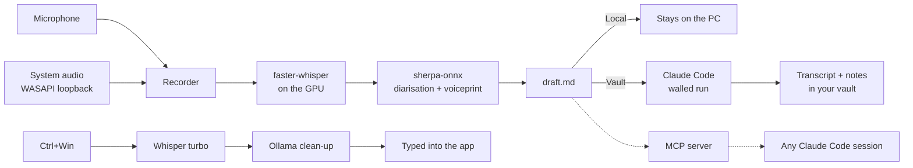

<div align="center">


# Scribe

**Offline dictation and meeting notes for Windows. Whisper runs on your GPU. Nothing you say leaves your PC.**

[](https://github.com/wimlrx/scribe/actions/workflows/ci.yml)
[](LICENSE)


</div>

Hold `Ctrl+Win`, speak, let go: your words are typed where the cursor is. Click **Notetaker** and Scribe records the call — your microphone and the computer's sound — then writes a speaker-labelled transcript, with your name on your lines. Optionally, it hands the finished transcript to [Claude Code](https://claude.com/claude-code) to turn into notes, decisions and a to-do list inside your own notes folder.

## Features

- **Push-to-talk dictation** into any app. Fillers, stutters and "no wait, I mean…" self-corrections are cleaned up by a small local model; numbers become digits; spoken lists become lists.
- **It learns your corrections.** Fix a word after dictating and Scribe remembers the spelling next time. Password fields are never read.
- **Meeting notetaker.** Mic and system audio on separate tracks, so calls in any app are captured. Stops itself after 20 minutes of silence.
- **Speaker labels.** Local diarisation separates voices; your enrolled voiceprint puts your name on your lines.
- **Mixed-language speech.** Picks the language per stretch of speech and never translates (built and tested on English/Afrikaans code-switching).
- **Files and videos.** Right-click any recording → *Send to* → Scribe. Videos also get notes on what was shown on screen, from a local vision model.
- **Claude Code integration** (optional): an MCP server lets Claude read your recordings and even a live transcript mid-call, and a walled hand-off turns a transcript into notes inside a folder you choose.
- **Shares the GPU.** Runs beside Ollama and other GPU work; if GPU memory runs out it retries, then finishes on the CPU.

## Privacy

- Speech is transcribed on **your** GPU with [faster-whisper](https://github.com/SYSTRAN/faster-whisper). No cloud speech API, no account, no telemetry.
- Clean-up and video notes use [Ollama](https://ollama.com) on `127.0.0.1`.
- Audio, transcripts and voiceprints live in `Documents\Scribe` and `%USERPROFILE%\.scribe`. Delete those folders and it is all gone.
- The **only** thing that ever leaves the PC is a transcript you explicitly send to a Claude Code vault. That run is locked down: no MCP servers, no connectors, no browser, file access limited to the job and that vault, and recorded speech is treated as data, never as instructions. Choose **Local** and nothing leaves at all.

## Requirements

| | |
|---|---|
| OS | Windows 10 or 11 |
| GPU | NVIDIA with ~6 GB free VRAM (CUDA 12 driver). CPU works, slowly. |
| Python | 3.13 |
| Disk | ~8 GB (PyTorch CUDA build + Whisper models) |
| Optional | [Ollama](https://ollama.com) for clean-up and video notes · [Claude Code](https://claude.com/claude-code) for notes and the MCP server |

## Install

```powershell
git clone https://github.com/wimlrx/scribe
cd scribe
powershell -ExecutionPolicy Bypass -File install.ps1
Start-Process "$env:APPDATA\Microsoft\Windows\Start Menu\Programs\Startup\Scribe.lnk"
```

The installer creates a virtual environment, installs the pinned packages, downloads the Whisper and speaker models, pulls the Ollama models if Ollama is installed, registers the MCP server if Claude Code is installed, and adds shortcuts (Startup, Desktop *Notetaker*, *Send to*). Running it again is safe. `install.ps1 -Uninstall` removes the shortcuts.

A grey microphone appears in the notification area.

## Use

| | |
|---|---|
| **Dictate** | Hold `Ctrl+Win`, speak, release. Pressing another key while holding cancels, so Windows shortcuts still work. Your clipboard is restored afterwards. |
| **Notetaker** | Click *Notetaker* on the Desktop, left-click the tray icon, or press `Ctrl+Alt+N`. Click the square on the small clock to stop, then pick where it goes. |
| **Files** | Right-click a recording or video → *Send to* → *Scribe*, or drop it into `Documents\Scribe\Inbox\<vault>\`. |
| **Tray colours** | Grey idle · Green dictating · Red recording · Amber working (with the queue count) |

Each job gets its own folder in `Documents\Scribe\Recordings\<date time>\` holding the audio, `whisper.json`, `speakers.json` and `draft.md` — the speaker-labelled transcript.

## Send transcripts to your notes (Claude Code)

Add your notes folders ("vaults") to `%USERPROFILE%\.scribe\settings.json`, then run `install.ps1` again to get a *Send to* entry for each:

```json
"owner_name": "Your Name",
"vaults": { "Work": "C:\\Notes\\Work", "Personal": "C:\\Notes\\Personal" }
```

After a recording, pick a vault. Claude Code runs headless inside it, reads the vault's own `CLAUDE.md` for its conventions, corrects names and terms against what the vault knows, and files the transcript, recording and a notes file (summary, decisions, to-do list) in its `Meetings\` folder. The session is kept, so you can resume it and talk the to-do list through.

### MCP tools

`install.ps1` registers Scribe's MCP server at user scope, so any Claude Code session can use it:

| Tool | Does |
|---|---|
| `status` | Recording or not, and the job queue |
| `recent_recordings` | Newest recordings with length, status and outputs |
| `transcript` | One recording's final transcript, draft, notes or speakers |
| `live_transcript` | Transcribes the current recording so far — ask Claude about the meeting while it is happening |
| `start_notetaker` / `stop_notetaker` | Start or stop recording |
| `send_to_vault` | Send a finished Local recording to a vault |

The server talks to the running app over a local pipe and opens no port. Transcript text is never written to the logs.

## How it works



The full design is in [docs/DESIGN.md](docs/DESIGN.md).

## Settings

`%USERPROFILE%\.scribe\settings.json` is written on first run. Edit it, then restart Scribe from the tray.

| Key | What it sets |
|---|---|
| `owner_name` | Your name on transcripts |
| `languages` | Languages Whisper may choose from, e.g. `["en"]` or `["en", "af"]` |
| `vocabulary` | Names and terms spelled your way |
| `dictation.model` | Whisper model for dictation (`large-v3-turbo`) |
| `dictation.cleanup.model` | Ollama model for clean-up (`gemma4:e4b`) |
| `meetings.model` | Whisper model for meetings and files (`large-v3`) |
| `meetings.cluster_threshold` | Higher merges more voices into one speaker |
| `vaults`, `default_vault` | Your notes folders and the highlighted choice |
| `claude.exe`, `claude.model` | The Claude Code program and model for the vault run |
| `ollama.url`, `ollama.vision_model` | Local model that describes video frames |
| `output_root` | Where `Recordings\` and `Inbox\` live (`Documents\Scribe`) |
| `notetaker_hotkey` | Default `ctrl+alt+n` |

## Command line

```text
.venv\Scripts\pythonw.exe scribe.pyw                              start Scribe
.venv\Scripts\pythonw.exe scribe.pyw --toggle-notetaker           start or stop the notetaker
.venv\Scripts\pythonw.exe scribe.pyw --add FILE [--vault NAME]    transcribe a file where it lies
.venv\Scripts\python.exe  scribe.pyw --status                     what is running (JSON)
.venv\Scripts\pythonw.exe scribe.pyw --retry FOLDER               retry a failed job
.venv\Scripts\pythonw.exe scribe.pyw --enhance FOLDER --vault NAME  send a Local job to a vault
.venv\Scripts\pythonw.exe scribe.pyw --quit                       close Scribe
```

## FAQ

**Does it work without an NVIDIA GPU?** Yes, on the CPU, but a 5-second dictation takes about 10 seconds and a meeting takes about its own length.

**Does it work without Ollama or Claude Code?** Yes. Without Ollama you get raw Whisper text; without Claude Code you get the speaker-labelled draft.

**Another dictation app also uses `Ctrl+Win`.** Quit it, or both will listen.

**Where are the logs?** `%USERPROFILE%\.scribe\logs\scribe.log`. Scribe shows no error dialogs; problems go to the log and a red ✕ flashes on screen.

## Tests

```powershell
.venv\Scripts\python.exe -m unittest discover -s tests
```

GPU, model and Ollama tests skip themselves when those are missing.

## Contributing

Issues and pull requests are welcome — see [CONTRIBUTING.md](CONTRIBUTING.md). Security reports: [SECURITY.md](SECURITY.md).

## Credits

[faster-whisper](https://github.com/SYSTRAN/faster-whisper) and OpenAI Whisper · [sherpa-onnx](https://github.com/k2-fsa/sherpa-onnx) with pyannote segmentation and WeSpeaker embeddings · [Ollama](https://ollama.com) · [PyAudioWPatch](https://github.com/s0d3s/PyAudioWPatch) · [pystray](https://github.com/moses-palmer/pystray) · the [MCP Python SDK](https://github.com/modelcontextprotocol/python-sdk).

## License

[MIT](LICENSE)
